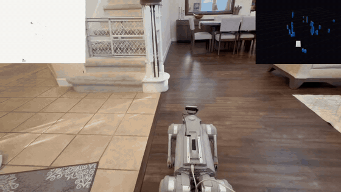
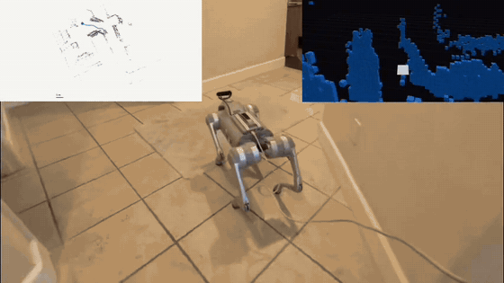
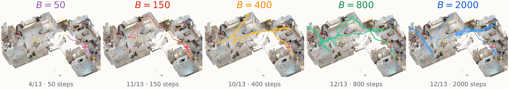
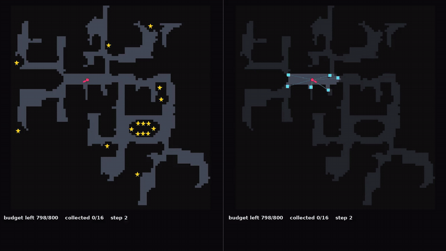
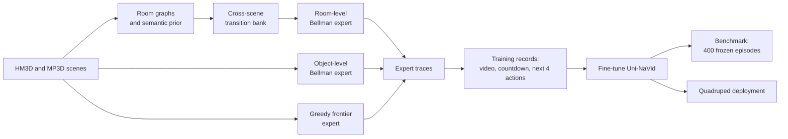
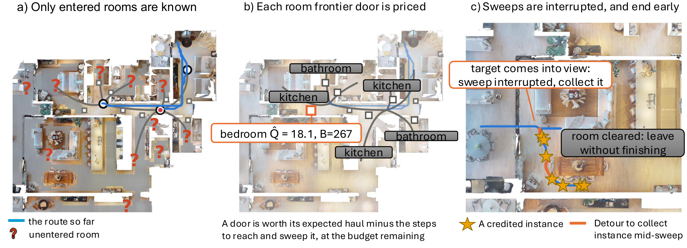
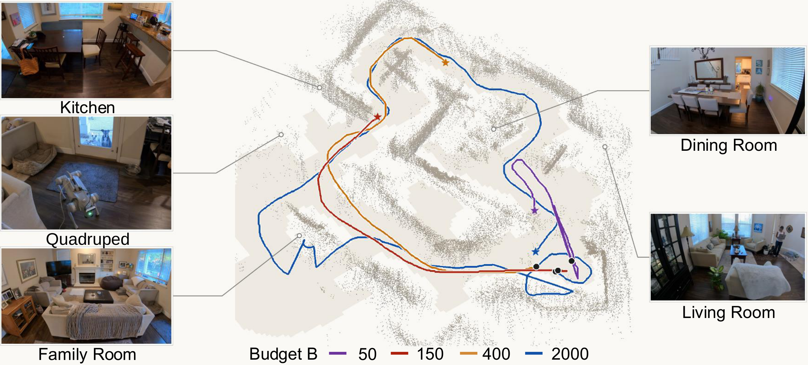

<h1 align="center">Racing the Clock</h1>
<h3 align="center">Teaching VLNs Budget-Conditioned Object Search</h3>

<p align="center">
  Maitree Meher*, Siming He*, S. Shankar Sastry, Jitendra Malik, Claire Tomlin, Jonas Frey<br>
  University of California, Berkeley &nbsp;·&nbsp; Stanford University<br>
  <sub>* Equal contribution</sub>
</p>

<p align="center">
  <b>Best Paper Award, IROS 2026 Workshop on Intelligent Information Gathering</b>
</p>

<p align="center">
  <a href="https://arxiv.org/abs/2611.17442"></a>
  <a href="https://goldengait.github.io/racing-the-clock/"></a>
  <a href="LICENSE"></a>
</p>

<p align="center">
  
  
</p>
<p align="center">
  <sub>The same policy in the same house and start location, given 150 steps (left) and 800 steps (right). Clips are sped up 4.53×.</sub>
</p>

A search robot has to split its budget between nearby targets and distant rooms. This repository holds the code for **budget-conditioned object search**: finding as many instances of a requested object as possible before an action budget runs out. It contains three search experts, the pipeline that turns their demonstrations into training data for a vision-language navigation model (Uni-NaVid), the benchmark, and the code that runs the trained model on a quadruped.

## What the paper shows

**The stated budget changes the search.** The trained model is rolled out from the same start in the same held-out scene with the same decoding. Only the budget in the instruction changes, and the routes diverge instead of extending one another.

<p align="center"></p>

**A stronger expert is not necessarily a better teacher.** The object-level expert knows every target location and scores highest as an expert. After each expert is distilled into the same model under matched conditions, the order reverses: supervision from the room-level expert, which has to search, gives the best student at every budget.

<p align="center"></p>
<p align="center"><sub>Left: the object-level expert, with every chair known from the first step. Right: the room-level expert, which sees only the rooms it has entered.</sub></p>

### Results

Mean % of reachable targets collected on ten held-out HM3D scenes (± 95% CI half-width), from the paper.

| Policy | B = 150 | B = 400 | B = 800 | B = 2000 |
|---|---:|---:|---:|---:|
| *Experts* | | | | |
| Greedy frontier expert | 24.4 ±6.3 | 52.1 ±7.1 | 85.8 ±4.6 | 93.8 ±2.9 |
| Object-level Bellman expert | 91.3 ±3.4 | 99.8 ±0.2 | 100.0 ±0.0 | 100.0 ±0.0 |
| Room-level Bellman expert (ours) | 45.7 ±9.8 | 91.6 ±6.4 | 97.1 ±4.2 | 98.0 ±3.5 |
| *Learned VLN policies* | | | | |
| Pretrained VLN | 28.3 ±6.1 | 35.5 ±6.2 | 38.8 ±6.6 | 44.8 ±7.0 |
| VLN trained on greedy frontier expert | 25.6 ±6.0 | 44.5 ±7.3 | 54.6 ±7.5 | 68.5 ±7.3 |
| VLN trained on object-level expert | 28.3 ±6.2 | 45.0 ±7.3 | 58.6 ±7.5 | 65.5 ±7.4 |
| **VLN trained on room-level expert (ours)** | **31.6** ±6.8 | **58.0** ±7.4 | **64.5** ±7.1 | **72.7** ±6.8 |

The per-episode results behind four of these rows ship in [`results/`](results/), and one command recomputes them:

```bash
python results/score.py
```

## How it works



Both Bellman experts solve the same budget-indexed recursion. They differ in what they are allowed to know:

| | Object-level expert | Room-level expert | VLN student |
|---|---|---|---|
| Knows | Map and every target location | Observed rooms, doorway evidence, cross-scene priors | RGB history and the countdown |
| Withheld | Nothing | Contents of unentered rooms | Everything unseen |
| Decides | Next target instance | Next room to enter | Next four primitive actions |

The budget reaches the model only as text: each training record ends with a natural-language countdown of the steps remaining. There is no numeric budget input and no change to the model architecture.

<p align="center"></p>

## Repository layout

| Folder | Contents |
|---|---|
| [`search/`](search/) | The experts, data generation, benchmark and visualization scripts, plus the room graphs, semantic prior and transition banks they use |
| [`training/`](training/) | The Uni-NaVid fine-tuning script and the patch it needs |
| [`results/`](results/) | Per-episode benchmark results and the scoring script |
| [`robot/`](robot/) | Deployment on a quadruped: inference server, robot client, safety and link tools |
| [`docs/`](docs/) | Installation, the pipeline step by step, and the data formats |

The main entry points in `search/`:

| Stage | Script | What it does |
|---|---|---|
| Scene abstraction | `build_room_graphs_hm3d.py`, `build_room_graphs.py` | Room graphs for HM3D and MP3D |
| | `build_prior.py`, `build_transition_bank.py` | Semantic prior and the cross-scene transition bank |
| Experts | `budget_planner.py` | The budget-indexed Bellman planner over the bank |
| | `c4_collect_expert.py` | Room-level expert, executed in simulation. `--policy greedy` gives the greedy frontier baseline |
| | `tsp_oracle.py` | Object-level expert: budgeted routing over known targets |
| Training data | `flatten_uninavid.py` | Expert traces to Uni-NaVid training records |
| | `check_contamination.py` | Refuses a dataset that overlaps the evaluation scenes |
| Evaluation | `bench_model.py` | A trained model on the 400 frozen episodes |
| | `rollout_gate.py` | Same episode at two budgets, to test that behavior changes |
| Visualization | `replay_render.py`, `expert_duel.py` | Replay a trace as video; two experts side by side |

## Getting started

Full instructions are in [`docs/INSTALL.md`](docs/INSTALL.md) and [`docs/PIPELINE.md`](docs/PIPELINE.md). In short:

```bash
git clone https://github.com/GoldenGait/racing-the-clock-code.git
cd racing-the-clock-code
export RTC_DATA=/path/to/data        # scenes, traces, datasets and checkpoints live here
```

Run each expert on one episode (simulator environment, one GPU):

```bash
cd search

# room-level Bellman expert, with the settings used in the paper
python c4_collect_expert.py --dataset hm3d --stem 5cdEh9F2hJL --cat chair --budget 400 \
    --approach 1 --anytime 1 --resweep 1 --trace-dir $RTC_DATA/traces/room_level

# greedy frontier baseline
python c4_collect_expert.py --dataset hm3d --stem 5cdEh9F2hJL --cat chair --budget 400 \
    --approach 1 --anytime 1 --policy greedy --trace-dir $RTC_DATA/traces/greedy

# object-level expert
python tsp_oracle.py --dataset hm3d --stem 5cdEh9F2hJL --cat chair --budget 400 \
    --out $RTC_DATA/traces/object_level/5cdEh9F2hJL_chair_B400
```

Then build training records, fine-tune, and benchmark:

```bash
python flatten_uninavid.py --trace-dir $RTC_DATA/traces/room_level --out-dir $RTC_DATA/dataset
bash ../training/train_uninavid.sh
python bench_model.py 0 1 0 $RTC_DATA/sft_ckpts/uninavid-budget $RTC_DATA/bench_out
python ../results/score.py "$RTC_DATA/bench_out/results_*.json"
```

## Data and checkpoints

| Item | Status |
|---|---|
| Room graphs, semantic prior, transition banks, evaluation scenes | In this repository, under `search/` |
| Benchmark definition (400 frozen episodes) and per-episode results | In this repository, under `results/` |
| Expert traces (recorded action sequences) | Room-level traces on Matterport3D are attached to the [releases](../../releases) page. More to follow |
| Trained model weights | Coming soon |
| Rendered training videos | Not distributed. Regenerate them from the traces with your own copy of the scenes |

The scenes themselves come from [HM3D](https://aihabitat.org/datasets/hm3d-semantics/) and [Matterport3D](https://niessner.github.io/Matterport/), under their own licenses. [`docs/DATA.md`](docs/DATA.md) describes every file format.

## Real-robot deployment

The trained model runs zero-shot on an indoor quadruped: an onboard camera streams RGB to a GPU server, which returns four primitives per call. [`robot/`](robot/) holds the inference server, the robot client and the safety tools, with its own README.

<p align="center"></p>

## Citation

```bibtex
@article{meher2026racing,
  title   = {Racing the Clock: Teaching VLNs Budget-Conditioned Object Search},
  author  = {Meher, Maitree and He, Siming and Sastry, S. Shankar and
             Malik, Jitendra and Tomlin, Claire and Frey, Jonas},
  journal = {arXiv preprint arXiv:2611.17442},
  year    = {2026}
}
```

## Acknowledgements

This work builds on [Uni-NaVid](https://github.com/jzhzhang/Uni-NaVid), which provides the model, its training code and the pretrained weights we fine-tune. Simulation uses [Habitat-Sim](https://github.com/facebookresearch/habitat-sim) with the [HM3D](https://aihabitat.org/datasets/hm3d-semantics/) and [Matterport3D](https://niessner.github.io/Matterport/) scene datasets. The robot client uses the [Unitree SDK2 Python interface](https://github.com/unitreerobotics/unitree_sdk2_python).

## License

The code in this repository is released under the [MIT License](LICENSE). Uni-NaVid, Habitat-Sim and the scene datasets are covered by their own licenses.
